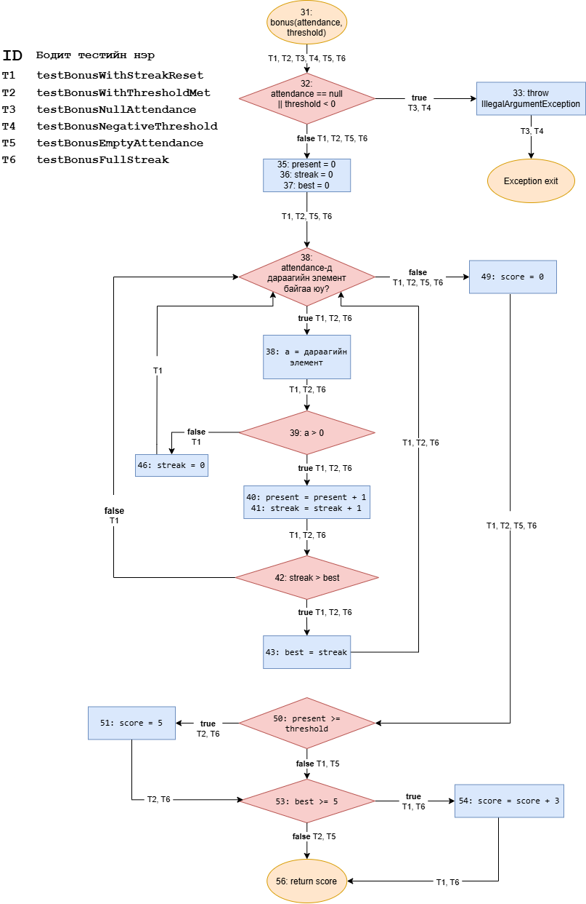

# Lab 10 - Data Flow Testing

**Оюутны нэр:** Туяацэцэг
**Оюутны код:** B210910804

## Ашигласан орчин

**Java:**
openjdk version "25.0.5.0.2" 2026-10-22 LTS
OpenJDK Runtime Environment Microsoft-15804669 (build 25.0.5.0.2+1-LTS)
OpenJDK 64-Bit Server VM Microsoft-15804669 (build 25.0.5.0.2+1-LTS, mixed mode, sharing)

**Maven:**
Apache Maven 3.10.0 (c43a36b8d67be7e0805a411bc0898af1a51f5472)
Maven home: /usr/local/sdkman/candidates/maven/current
Java version: 25.0.5.0.2, vendor: Microsoft, runtime: /usr/local/sdkman/candidates/java/25.0.5.0+2-ms
Default locale: en, platform encoding: UTF-8, time zone: Etc/UTC
OS name: "linux", version: "6.8.0-1070-azure", arch: "amd64", family: "unix"

## A. gcd() функцийн DU шинжилгээ

### 1. Def/Use цэгүүд

gcd() функцийн x, y, tmp хувьсагчдын def болон
use цэгүүдийг эх кодын мөрийн дугаараар тодорхойлов.

| Мөр | Үйлдэл | Definition | Use |
|---|---|---|---|
| 13 | gcd(int x, int y) | x, y | - |
| 14 | int tmp | - | - |
| 15 | while (y != 0) | - | y (p-use) |
| 16 | tmp = x % y | tmp | x, y (c-use) |
| 17 | x = y | x | y (c-use) |
| 18 | y = tmp | y | tmp (c-use) |
| 20 | return x | - | x (c-use) |

15-р мөрийн нөхцөлийн T/F салааг шалгасан.
G1 дээр нөхцөл эхнээсээ false.
G2 дээр давталтын явцад true, дараа нь false болсон.

### 2. DU хосууд

Нийт 11 DU хос тодорхойлсон:

- x: 4 хос
- y: 6 хос
- tmp: 1 хос

| Хувьсагч | Def мөр | Use мөр | Төрөл | Def-clear зам | Тестийн ID | Хамрагдсан |
|---|---|---|---|---|---|---|
| x | 13 | 16 | c-use | 13→15→16 | G2, G3 | Тийм |
| x | 13 | 20 | c-use | 13→15→20 | G1 | Тийм |
| x | 17 | 16 | c-use | 17→18→15→16 | G2 | Тийм |
| x | 17 | 20 | c-use | 17→18→15→20 | G2, G3 | Тийм |
| y | 13 | 15 | p-use | 13→15 | G1, G2, G3 | Тийм |
| y | 13 | 16 | c-use | 13→15→16 | G2, G3 | Тийм |
| y | 13 | 17 | c-use | 13→15→16→17 | G2, G3 | Тийм |
| y | 18 | 15 | p-use | 18→15 | G2, G3 | Тийм |
| y | 18 | 16 | c-use | 18→15→16 | G2 | Тийм |
| y | 18 | 17 | c-use | 18→15→16→17 | G2 | Тийм |
| tmp | 16 | 18 | c-use | 16→17→18 | G2, G3 | Тийм |

### 3. JUnit тест

3 тест бичиж ажиллуулав.

| Тест | Оролт | Expected |
|---|---|---|
| testGcdWithoutLoop | (7, 0) | 7 |
| testGcdWithTwoIterations | (12, 8) | 4 |
| testGcdWithZeroFirstInput | (0, 5) | 5 |

gcd(7, 0) нь давталтад орохгүй тул x-ийн
13→20 хосыг хамарсан.

gcd(12, 8) нь 2 давталт хийсэн.
Ингэснээр давталтын дараагийн эргэлтэд
ашиглагдах DU хосууд хамрагдсан.

### 4. Үр дүн

mvn test:
- Tests run: 3, Failures: 0, Errors: 0, Skipped: 0
BUILD SUCCESS

Үр дүн: gcd() функцийн тодорхойлсон DU хосууд
бүгд сонгосон тестүүдээр хамрагдсан.

## B. bonus() функцийн өгөгдлийн урсгалын шинжилгээ

### B1. CFG диаграм



### B2. Def/Use жагсаалт

| Мөр | Үйлдэл | Def | Use |
|---|---|---|---|
| 31 | bonus(int[] attendance, int threshold) | attendance, threshold | - |
| 32 | attendance == null || threshold < 0 | - | attendance, threshold (p-use) |
| 33 | throw IllegalArgumentException | - | - |
| 35 | present = 0 | present | - |
| 36 | streak = 0 | streak | - |
| 37 | best = 0 | best | - |
| 38 | for (int a : attendance) | a | attendance (p-use) |
| 39 | if (a > 0) | - | a (p-use) |
| 40 | present = present + 1 | present | present (c-use) |
| 41 | streak = streak + 1 | streak | streak (c-use) |
| 42 | if (streak > best) | - | streak, best (p-use) |
| 43 | best = streak | best | streak (c-use) |
| 46 | streak = 0 | streak | - |
| 49 | score = 0 | score | - |
| 50 | if (present >= threshold) | - | present, threshold (p-use) |
| 51 | score = 5 | score | - |
| 53 | if (best >= 5) | - | best (p-use) |
| 54 | score = score + 3 | score | score (c-use) |
| 56 | return score | - | score (c-use) |

### B3. DU хосууд

DU хосуудыг хувьсагч бүрээр нь тодорхойлов.
Давталтын үед утга дахин оноогдох болон
өмнөх утга хүчингүй болох замуудыг шалгав.

#### present

| Def | Use | Төрөл | Def-clear зам | Тестийн ID | Хамрагдсан |
|---|---|---|---|---|---|
| 35 | 40 | c-use | 35→38→39→40 | T1, T2, T6 | Тийм |
| 35 | 50 | p-use | 35→38→49→50 | T5 | Тийм |
| 40 | 40 | c-use | 40→38→39→40 | T1, T2, T6 | Тийм |
| 40 | 50 | p-use | 40→38→49→50 | T1, T2, T6 | Тийм |

#### streak

| Def | Use | Төрөл | Def-clear зам | Тестийн ID | Хамрагдсан |
|---|---|---|---|---|---|
| 36 | 41 | c-use | 36→38→39→41 | T1, T2, T6 | Тийм |
| 41 | 41 | c-use | 41→38→39→41 | T1, T2, T6 | Тийм |
| 41 | 42 | p-use | 41→42 | T1, T2, T6 | Тийм |
| 41 | 43 | c-use | 41→42→43 | T1, T2, T6 | Тийм |
| 46 | 41 | c-use | 46→38→39→41 | T1 | Тийм |

#### best

| Def | Use | Төрөл | Def-clear зам | Тестийн ID | Хамрагдсан |
|---|---|---|---|---|---|
| 37 | 42 | p-use | 37→38→39→41→42 | T1, T2, T6 | Тийм |
| 37 | 53 | p-use | 37→38→49→50→53 | T5 | Тийм |
| 43 | 42 | p-use | 43→38→39→41→42 | T1, T2, T6 | Тийм |
| 43 | 53 | p-use | 43→38→49→50→53 | T1, T2, T6 | Тийм |

#### score

| Def | Use | Төрөл | Def-clear зам | Тестийн ID | Хамрагдсан |
|---|---|---|---|---|---|
| 49 | 54 | c-use | 49→50(F)→53(T)→54 | T1 | Тийм |
| 49 | 56 | c-use | 49→50(F)→53(F)→56 | T5 | Тийм |
| 51 | 54 | c-use | 51→53(T)→54 | T6 | Тийм |
| 51 | 56 | c-use | 51→53(F)→56 | T2 | Тийм |
| 54 | 56 | c-use | 54→56 | T1, T6 | Тийм |

#### a

| Def | Use | Төрөл | Def-clear зам | Тестийн ID | Хамрагдсан |
|---|---|---|---|---|---|
| 38 | 39 | p-use | 38(a оноох)→39 | T1, T2, T6 | Тийм |

#### attendance

| Def | Use | Төрөл | Def-clear зам | Тестийн ID | Хамрагдсан |
|---|---|---|---|---|---|
| 31 | 32 | p-use | 31→32 | T1, T3, T4 | Тийм |
| 31 | 38 | p-use | 31→32(F)→35→36→37→38 | 	T1, T2, T5, T6 | Тийм |

#### threshold

| Def | Use | Төрөл | Def-clear зам | Тестийн ID | Хамрагдсан |
|---|---|---|---|---|---|
| 31 | 32 | p-use | 31→32 | T1, T4 | Тийм |
| 31 | 50 | p-use | 31→32(F)→35→38→49→50 | 	T1, T2, T5, T6 | Тийм |

#### Kill

46-р мөрийн streak = 0 үйлдэл нь streak-ийн
өмнөх definition-ийг хүчингүй болгоно.

Жишээ нь 41→46→41 замыг def-clear гэж үзэхгүй.
Учир нь 46-р мөрөнд streak дахин тодорхойлогдсон.

Харин 46→41 нь шинэ definition-ээс эхэлсэн
DU хос болно.

#### Def-clear замын хязгаарлалт

- 35→40→50 зам нь present-ийн 35→50 DU хосын
  def-clear зам биш. 40-р мөр present-д шинэ утга онооно.
- 36→41→41 зам нь streak-ийн 36→41 хосын
  def-clear зам биш. Эхний 41-р мөр streak-ийг өөрчилнө.
- 41→46→41 зам нь streak-ийн 41→41 хосын
  def-clear зам биш. 46-р мөр өмнөх утгыг хүчингүй болгоно.
- 37→43→53 зам нь best-ийн 37→53 хосын
  def-clear зам биш. 43-р мөр best-ийг шинэчилнэ.
- 49→51→56 зам нь score-ийн 49→56 хосын
  def-clear зам биш. 51-р мөр score-ийг өөрчилнө.

Эдгээр замыг DU хамралтад тооцоогүй.

### B4. All-defs тест

All-defs хамралтад 2 тест бичиж ажиллуулав.

| Тест | Оролт | Expected |
|---|---|---|
| testBonusWithStreakReset | {1,1,1,1,1,0,1,1}, threshold=9 | 3 |
| testBonusWithThresholdMet | {1,1}, threshold=1 | 5 |

Эхний тестээр streak-ийн reset болон best-ийн
шинэчлэлтийг шалгасан. score-ийн 49, 54-р
мөрийн definition-үүд use-д хүрсэн.

Хоёр дахь тестээр score-ийн 51-р мөрийн
definition 56-р мөрийн return-д хүрсэн.

score-ийн бүх definition-ийг нэг тестээр
хамруулах боломжгүй. Учир нь 51-р мөр
ажиллахад 49-р мөрийн score-ийн утга
дарагдана. Харин 51-р мөрийг алгасвал
түүний definition хамрагдахгүй.

Иймээс хамгийн багадаа 2 тест шаардлагатай.

#### Тестийн үр дүн

mvn verify:

- BonusTest: 2 тест
- GcdTest: 3 тест
- Tests run: 5
- Failures: 0
- Errors: 0
- Skipped: 0

BUILD SUCCESS

#### JaCoCo хамралт

jacoco-alldefs.csv:

| Хэмжүүр | Missed | Covered | Нийт | Хамралт |
|---|---|---|---|---|
| Branch | 2 | 14 | 16 | 87.5% |
| Line | 2 | 22 | 24 | 91.7% |

All-defs тестүүдээр бүх definition-ийг
use-д хүргэсэн боловч branch хамралт
100% болоогүй.

Энэ нь all-defs болон branch coverage
хоёр өөр шалгуур болохыг харуулж байна.

Тестийн гаралт:
results/mvn-verify-alldefs.txt

JaCoCo CSV:
results/jacoco-alldefs.csv

### B4. All-DU-pairs тест

All-defs-ийн 2 тест дээр 4 тест нэмж,
BonusTest-ийн нийт тестийн тоог 6 болгов.

| Тест | Шалгасан нөхцөл | Expected |
|---|---|---|
| testBonusNullAttendance | attendance = null | IllegalArgumentException |
| testBonusNegativeThreshold | threshold = -1 | IllegalArgumentException |
| testBonusEmptyAttendance | attendance = {}, threshold = 1 | 0 |
| testBonusFullStreak | attendance = {1,1,1,1,1}, threshold = 5 | 8 |

Нэмэлт тестүүдээр буруу оролт, хоосон массив,
мөн ирцийн болон дараалсан ирцийн урамшууллыг
хамтад нь авах замуудыг шалгав.

mvn verify:
- BonusTest: 6 тест
- GcdTest: 3 тест
- Tests run: 9
- Failures: 0
- Errors: 0
- Skipped: 0

BUILD SUCCESS

#### Тестийн ID

| ID | Тестийн метод |
|---|---|
| T1 | testBonusWithStreakReset |
| T2 | testBonusWithThresholdMet |
| T3 | testBonusNullAttendance |
| T4 | testBonusNegativeThreshold |
| T5 | testBonusEmptyAttendance |
| T6 | testBonusFullStreak |

#### JaCoCo хамралт

| Хэмжүүр | Missed | Covered | Нийт | Хамралт |
|---|---|---|---|---|
| Branch | 0 | 16 | 16 | 100% |
| Line | 1 | 23 | 24 | 95.8% |

Branch хамралт 100% болсон.
LINE_MISSED = 1 нь 7-р мөрийн далд constructor.

Branch coverage нь нөхцөлийн салааг хэмждэг.
Харин DU coverage нь хувьсагчид утга оноосон
цэгээс ашигласан цэг хүртэлх замыг шалгадаг.
Тиймээс branch 100% байсан ч DU хос
хамрагдаагүй байх боломжтой.

## C. Fault seeding

DataFlowTargets.java файлд 3 төрлийн мутацийг
нэг нэгээр нь хийж, JUnit тестүүдээр шалгав.

### C1. Мутацийн үр дүн

| Мутаци | Өөрчлөлт | Тестийн үр дүн |
|---|---|---|
| M1 | streak = streak + 1 мөрийг устгасан | 9 тестээс 2 унасан |
| M2 | best = streak-ийг best = present болгосон | 9 тест бүгд амжилттай |
| M2-kill | M2-ийг илрүүлэх нэмэлт тест | 10 тестээс 1 унасан |
| M3 | Ашиглагдахгүй total хувьсагч нэмсэн | 10 тест бүгд амжилттай |

### C2. M1

M1 мутацид streak-ийн шинэчлэлтийг устгасан.

Унасан тестүүд:

| Тест | Expected | Actual |
|---|---|---|
| testBonusWithStreakReset | 3 | 0 |
| testBonusFullStreak | 8 | 5 |

Дараалсан ирцийн тоо нэмэгдэхгүй болсон тул
хоёр тест алдааг илрүүлсэн.

Үр дүн: results/mvn-test-M1.txt

### C3. M2

M2 мутацид best = streak мөрийг
best = present болгон өөрчилсөн.

Эхний 9 тест бүгд амжилттай ажилласан.
Иймээс M2 мутаци амьд үлдсэн.

Өмнөх тестүүдэд best шинэчлэгдэх үед
present болон streak-ийн утга ижил байх,
эсвэл буруу шинэчлэл нь эцсийн оноонд
нөлөөлөхгүй байх нөхцөлүүд орсон байсан.

Үүнийг шалгахын тулд дараах тестийг нэмсэн:

testBonusWrongBestUpdate

Оролт:
attendance = {1,0,1,1,1,1}
threshold = 9

Зөв кодын үр дүн: 0
M2 мутацийн үр дүн: 3

Нэмэлт тест M2 мутацийг илрүүлсэн.

Үр дүн:
- results/mvn-test-M2.txt
- results/mvn-test-M2-kill.txt

### C4. M3

M3 мутацид дараах мөрийг нэмсэн:

```java
int total = present + best;
```

total хувьсагчид утга оноосон боловч
дараа нь ашиглаагүй.

10 тест бүгд амжилттай ажилласан.
Учир нь total хувьсагч функцийн буцаах
утгад нөлөөлөхгүй.

Энэ нь dead definition юм.
JUnit тестээр илрээгүй бөгөөд static analysis
ашиглан илрүүлэх боломжтой.

Java compiler энэ мөрийг алдаа гэж үзээгүй.

Үр дүн: results/mvn-test-M3.txt

VS Code-ийн Problems хэсэгт:
"No problems have been detected in the workspace."
гэсэн мэдээлэл гарсан.

M3-ийн ашиглагдаагүй total хувьсагчийг IDE
анхааруулга болгон илрүүлээгүй.
Java compiler мөн алдаа гаргаагүй.
Ийм dead definition-ийг илрүүлэхэд
static analysis-ийн нэмэлт шалгалт шаардлагатай.

### C5. Эх кодын шалгалт

Мутаци бүрийн дараа DataFlowTargets.java
файлыг git restore командаар сэргээсэн.

Starter commit-тэй харьцуулахад src/main/
хэсэгт өөрчлөлт гараагүй.

## Эцсийн тестийн үр дүн

mvn verify:

- BonusTest: 7 тест
- GcdTest: 3 тест
- Tests run: 10
- Failures: 0
- Errors: 0
- Skipped: 0

BUILD SUCCESS

### JaCoCo

| Хэмжүүр | Missed | Covered | Хамралт |
|---|---|---|---|
| Branch | 0 | 16 | 100% |
| Line | 1 | 23 | 95.8% |

LINE_MISSED = 1 нь 7-р мөрийн далд constructor.

Эцсийн үр дүн:
- results/mvn-verify-final.txt
- results/jacoco-final.csv

## Дүгнэлт

Энэ лабораторид gcd() болон bonus() функцүүдийн
өгөгдлийн урсгалыг шинжилж, DU хосуудыг тодорхойлсон.
Хувьсагчийн утга хаана оноогдож, хаана ашиглагдаж
байгааг def-clear замаар шалгасан.
All-defs хамралтад 2 тест ашигласан бөгөөд
дараа нь нэмэлт тестүүдээр DU хосуудыг шалгасан.
Эцсийн JaCoCo branch хамралт 100% болсон.
Гэхдээ branch coverage нь хувьсагчийн def-use
холбоос бүрийг хэмждэггүй учраас дангаараа хангалтгүй.
DU шинжилгээ нь илүү нарийн боловч замуудыг
гараар тодорхойлох, шалгахад цаг их шаардсан.
Ялангуяа bonus() функцийн давталт болон
дахин тодорхойлолтуудыг шинжлэхэд хамгийн их цаг зарцуулсан.

## AI туслахын хэрэглээ

ChatGPT ашиглан лабораторийн зааврыг тайлбарлуулах,
DU хүснэгт болон JUnit тест боловсруулахад тусламж авсан.
Мөн тестийн алдааг шалгах, Git болон Linux командуудыг
ажиллуулахад заавар авсан.
Тестүүдийг GitHub Codespaces дээр ажиллуулж,
үр дүнг Maven болон JaCoCo ашиглан шалгасан.